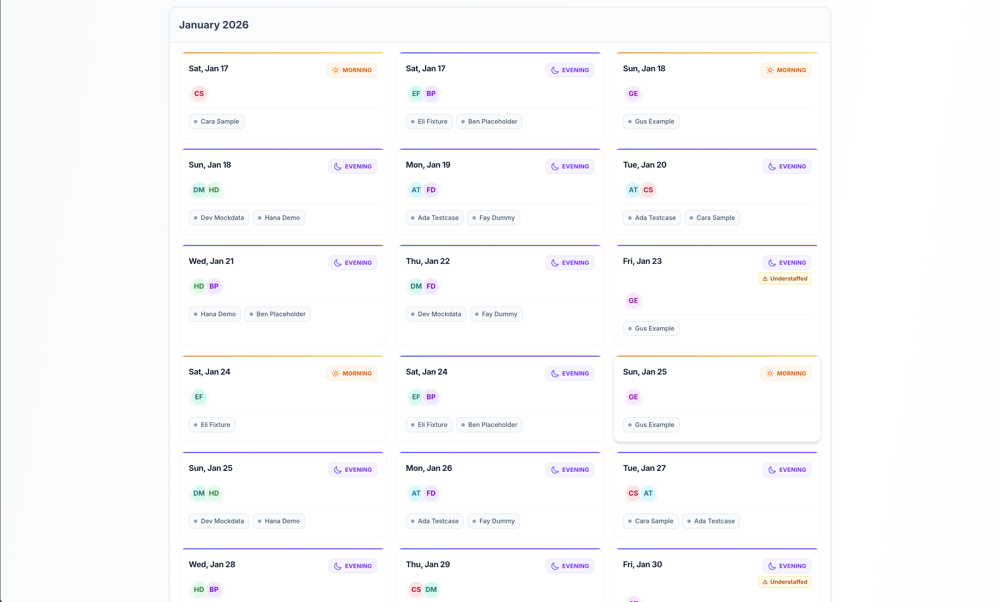
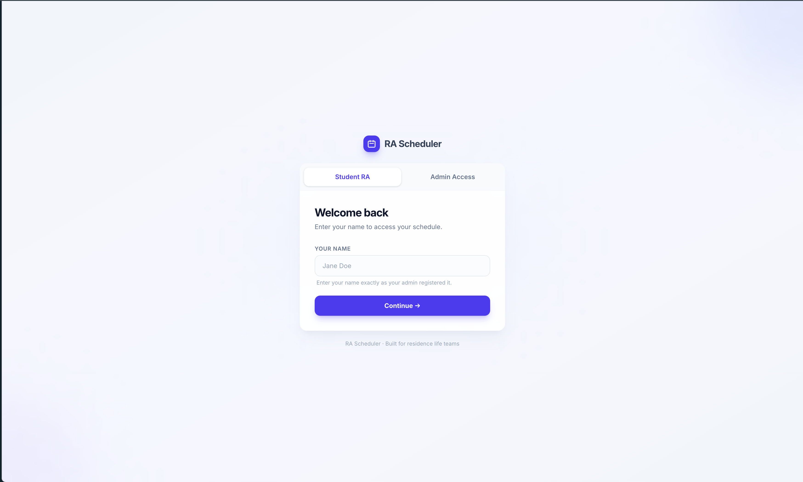
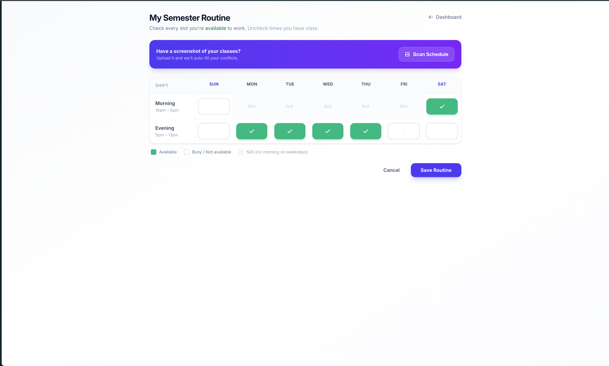

# RA Scheduler

[](https://github.com/Ferannn-TDE/ra-scheduler/actions/workflows/ci.yml)


[](LICENSE)

**Fair, availability-aware duty scheduling for Resident Assistant teams. RAs enter when they can work, and the admin generates and publishes a balanced semester roster in one click.**

**[Live demo → ra-scheduler-feran.vercel.app](https://ra-scheduler-feran.vercel.app)** (the class-timetable scan is turned off in the demo)

### Try the demo

The demo runs on a demo database filled with made-up RAs. Other visitors can change it, and it is reset from time to time.

- **RA login:** on the **Student RA** tab, type a name from the seed data, such as `Ada Testcase`.
- **Admin login:** on the **Admin Access** tab, email `DEMO_ADMIN_EMAIL`, password `DEMO_ADMIN_PASSWORD`.
- **The class-timetable scan is turned off** in the demo (no Gemini key is configured).

**30-second tour**

1. Sign in as the admin and open **Admin Console**.
2. Set the date range to start this month, then press **Generate Schedule**.
3. Look at the fairness chart and stat cards, then find a Friday evening card with the **Understaffed** flag (the seed data has only one RA free on Fridays).
4. Press **Publish Live**, sign out, sign in as `Ada Testcase`, open **View Final Schedule** and press **Add … shifts to Calendar** to download an `.ics` file.

## What it is

University housing teams staff a duty rotation every night of the semester. Building that roster by hand in a spreadsheet is slow and it's hard to keep fair. RA Scheduler replaces the spreadsheet:

- **Resident Assistants** sign in, mark the weekly shifts they can work and the ones they'd prefer. They can also upload a screenshot of their class timetable and let AI fill in their availability. Once the schedule is published, they can export their shifts to their calendar.
- **Admins** pick a date range, generate a schedule that balances shifts across the team, review the fairness chart and any understaffed shifts, then publish it to everyone.

It is a mobile-friendly, installable web app built with React, TypeScript and Supabase.



## Screenshots

| Login | RA availability |
|---|---|
|  |  |

## Features

- **Availability and shift preferences**: each RA sets a weekly template of shifts they *can* work, then marks the ones they'd *like* to work.
- **Class-timetable scan with Gemini**: upload a screenshot of a class schedule. Google Gemini finds evening class conflicts and the availability grid updates automatically. Needs a Gemini API key, so it is turned off in the live demo.
- **Fair scheduling with understaffed flags**: the generator balances total shifts per RA, honors preferences as a tie-breaker, and flags any shift it could not fully staff.
- **Fairness chart**: a bar chart of shifts per RA against the team average, plus min / max / average stat cards.
- **Publish / unpublish**: publishing replaces the live roster for the date range and records who published it. Any published range can be unpublished (deleted) from the history list.
- **.ics calendar export**: RAs download their own shifts as a calendar file for Google Calendar, Apple Calendar or Outlook.
- **Installable PWA**: works as a home-screen app on phones, with offline caching of the app shell.

## How the scheduler works

The generator (`src/utils/scheduler.ts`) walks through every day in the selected range, one shift at a time. **Staffing rules:** every evening needs 2 RAs. Morning shifts exist only on Saturday and Sunday and need 1 RA. For each shift, the only candidates are RAs who marked that weekday and shift as available. Candidates are ranked by a score: **the number of shifts they've already been given in this schedule, minus 0.5 if they marked the shift as a preference**. The lowest scores fill the slots, and their counts go up before the next shift is filled. Because a preference is worth half a shift, it breaks ties between RAs with equal workloads but never beats someone who has a full shift fewer. When RAs have similar availability, this keeps totals within about one shift of each other. If too few RAs are available, the shift gets as many as possible and is marked **understaffed**. Counts start at zero for each generation, and an RA may be given both shifts on the same day.

## Tech stack

| Layer | Technology |
|---|---|
| UI | React 19, React Router 7, Tailwind CSS 4, Recharts |
| Language and build | TypeScript 5.9, Vite 7, vite-plugin-pwa |
| Backend | Supabase (Postgres, Row Level Security, Auth, Storage) |
| AI | Google Gemini via `@google/genai` (timetable image analysis) |
| Dates | date-fns |
| Hosting | Vercel (static build with SPA rewrites in `vercel.json`) |
| Quality and automation | ESLint, Vitest, GitHub Actions (CI, plus a keep-alive ping for the demo database) |

## Project structure

```
.
├── public/                  # App icons, favicon, PWA assets
├── src/
│   ├── components/          # Shared UI: ShiftCard, FairnessChart, modals, route guard
│   ├── constants/           # Day names and shift rules
│   ├── hooks/               # useAlert
│   ├── pages/               # One file per route (Login, Dashboard, AdminScheduler, ...)
│   ├── types/               # Row types for the Supabase tables
│   ├── utils/               # scheduler, .ics export, Gemini scan, Supabase client (+ tests)
│   ├── App.tsx              # Routes (lazy-loaded)
│   └── main.tsx             # Entry point
├── supabase/
│   ├── schema.sql           # Tables, RLS policies and storage bucket
│   └── seed.sql             # Made-up demo RAs, availability and preferences
├── docs/                    # Roadmap and screenshots
├── vercel.json              # Vercel build settings, SPA rewrites, PWA headers
└── .github/workflows/
    ├── ci.yml               # Lint, test and build on every push and PR
    └── keepalive.yml        # Pings the demo database every 3 days so it doesn't pause
```

## Getting started

**Prerequisites:** Node.js 20.19 or newer and a free [Supabase](https://supabase.com) project. A [Gemini API key](https://aistudio.google.com/apikey) is optional and only needed for the timetable scan; everything else works without it.

1. **Install dependencies**
   ```bash
   npm install
   ```
2. **Create a Supabase project** at [supabase.com](https://supabase.com/dashboard).
3. **Create the database.** In the Supabase dashboard, open **SQL Editor**, paste in [`supabase/schema.sql`](supabase/schema.sql) and run it. This creates the tables and RLS policies.
4. **Create the storage bucket.** The schema script creates a public bucket named `schedule`. If you skipped that part, go to **Storage → New bucket**, name it `schedule`, and make it **Public**.
5. **Create an admin user.** Go to **Authentication → Users → Add user** and create an account with email and password. Then, under **Authentication → Sign In / Providers**, turn off "Allow new users to sign up". The app treats every signed-in Supabase user as an admin.
6. **Configure environment variables**
   ```bash
   cp .env.example .env.local
   ```
   Fill in the values from **Project Settings → API**, and your Gemini key if you want the timetable scan (see below).
7. **Run the app**
   ```bash
   npm run dev
   ```
   Open http://localhost:5173. Use **Student RA** to sign in by name, or **Admin Access** with the user from step 5.

### Demo setup

To try the app with sample data instead of a real team, use a fresh Supabase project:

1. **Create a new Supabase project.**
2. **Run [`supabase/schema.sql`](supabase/schema.sql)** in the SQL Editor.
3. **Run [`supabase/seed.sql`](supabase/seed.sql)** in the SQL Editor. It adds 8 made-up RAs (Ada Testcase, Ben Placeholder, ...) with a mix of availability and preferences. Nothing is published yet.
4. **Check the storage bucket.** Make sure a public bucket named `schedule` exists (schema.sql creates it).
5. **Create an admin user** under **Authentication → Users → Add user**.

Then follow steps 6–7 above. Sign in as the admin, open the scheduler and press **Generate Schedule**. Friday evenings are deliberately short-staffed in the seed data, so you'll see the understaffed flag. To see the RA side, sign in on the **Student RA** tab with a seeded name such as `Hana Demo`.

### Environment variables

| Variable | Required | Description |
|---|---|---|
| `VITE_SUPABASE_URL` | Yes | Supabase project URL, e.g. `https://your-project.supabase.co` |
| `VITE_SUPABASE_ANON_KEY` | Yes | Supabase publishable (anon) key. Safe in the browser; access is controlled by RLS |
| `VITE_GEMINI_API_KEY` | No | Google Gemini API key for the timetable scan. Without it, the scan shows an error and the rest of the app works. It is bundled into the browser build, so restrict it by HTTP referrer |

### Deploying to Vercel

1. Import the GitHub repo in Vercel. `vercel.json` already sets the Vite build, the `dist` output, a rewrite to `index.html` for client-side routes, and caching headers for the service worker and assets.
2. Add `VITE_SUPABASE_URL` and `VITE_SUPABASE_ANON_KEY` under **Settings → Environment Variables** for Production and Preview. Add `VITE_GEMINI_API_KEY` only if you want the timetable scan.
3. Deploy. Pushes to `main` deploy to production automatically.

To keep a free Supabase project from pausing, add `SUPABASE_URL` and `SUPABASE_ANON_KEY` as GitHub repository secrets. The `keepalive.yml` workflow then makes one read-only request every 3 days.

### Scripts

| Command | What it does |
|---|---|
| `npm run dev` | Start the dev server with hot reload |
| `npm run build` | Type-check and build for production into `dist/` |
| `npm run preview` | Serve the production build locally |
| `npm run lint` | Run ESLint |
| `npm test` | Run the unit tests (Vitest) |

## Known limitations

- **Name-only RA login.** RAs sign in by typing their name, with no password. Anyone who knows an RA's name can act as them. Admin accounts use real Supabase Auth.
- **Gemini key is exposed to the browser.** The timetable scan calls Gemini directly from the client, so the key ships in the JavaScript bundle. That's why the scan is turned off in the live demo. Planned fix: move the call into a Supabase Edge Function.
- **Uploaded timetables are in a public bucket.** Anyone with a file's URL can view it. Planned fix: private bucket with signed URLs.
- **Every signed-in Supabase user is an admin.** There are no roles, so keep public sign-ups turned off in Supabase Auth.
- **Fixed date windows.** The admin scheduler opens on a hard-coded Jan 17 – May 17, 2026 range (it can be changed before generating). The RA roster shows from the start of the current month to six months ahead, so older schedules aren't visible.
- **Times are fixed to Central time (America/Chicago).** Shift hours and the `.ics` export assume one timezone. Teams elsewhere need to change `CALENDAR_TIMEZONE` in `src/utils/ics.ts`.
- **Tests cover the core logic only.** Unit tests cover the scheduler and calendar export. There are no component or end-to-end tests yet.

## Roadmap

Planned work, including shift swaps, roster management, a pre-publish review step, browsing past schedules and moving the Gemini call server-side, is in [docs/ROADMAP.md](docs/ROADMAP.md).

## License

[MIT](LICENSE) © 2026 Oluwaferanmi Odedairo
